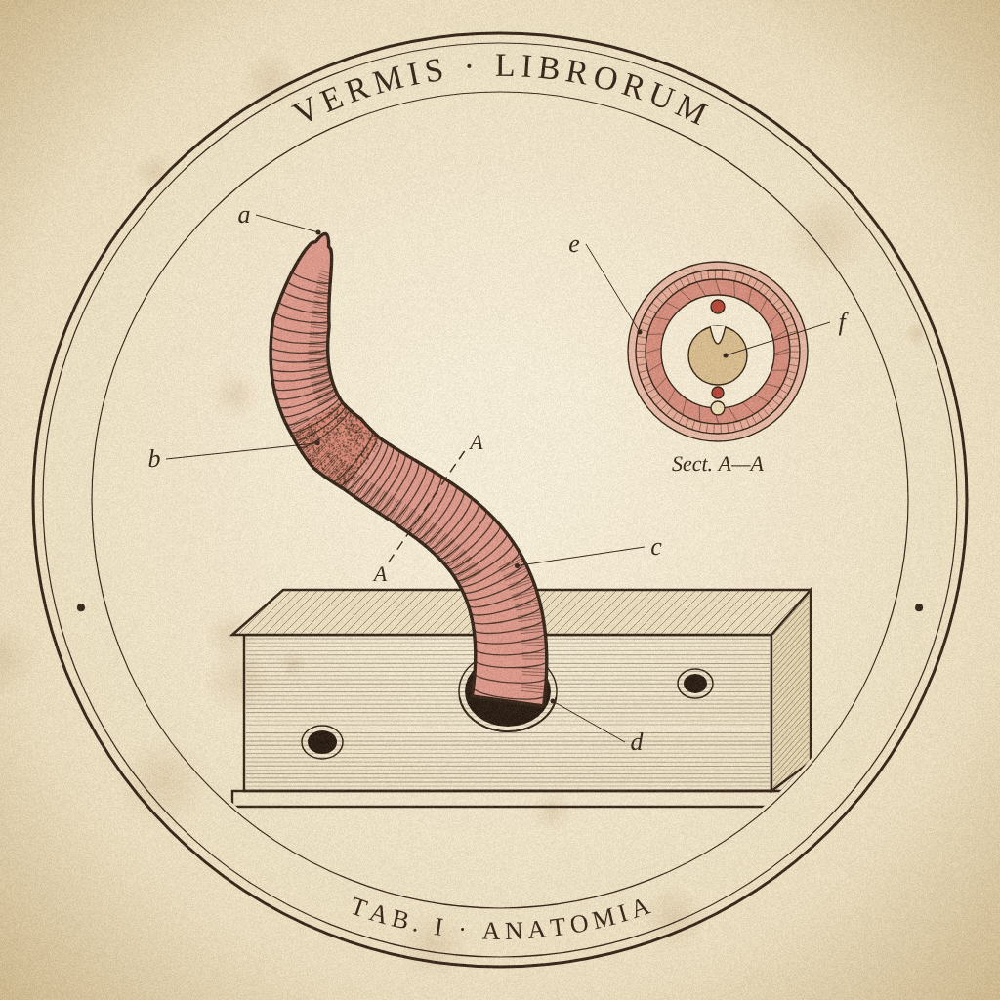
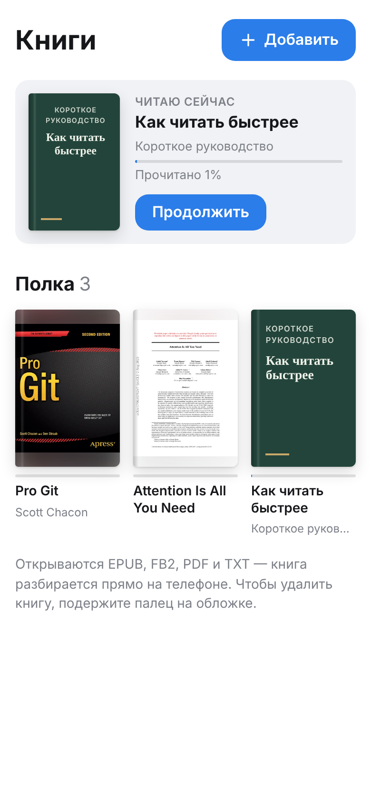
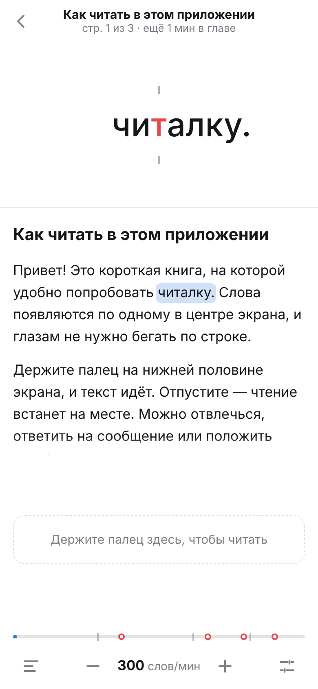
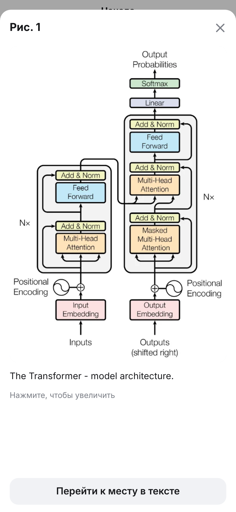

<p align="center">
  
</p>

<h1 align="center">Vermis librorum <sub>speed reader</sub></h1>

<p align="center">
  Книжный червь для Telegram: бот и мини-приложение для чтения книг по одному слову.<br />
  Пришлите EPUB, FB2, PDF или TXT — и читайте прямо в Telegram.
</p>

<p align="center">
  <a href="https://t.me/{{BOT}}"><b>Открыть бота</b></a> ·
  <a href="https://cybertatar.github.io/telegramspeedreader/">Веб-версия</a> ·
  <a href="#как-пользоваться">Как пользоваться</a> ·
  <a href="#как-устроено">Как устроено</a>
</p>

<p align="center">
  
  
  
  
</p>

## Что это

Слова появляются по одному в одной точке экрана (метод RSVP). Глазам не нужно прыгать по
строке и искать её начало, поэтому читать получается быстрее. Одна буква в каждом слове
подсвечена и всегда стоит под засечками — на неё взгляд и опирается.

Главная проблема такого чтения — отвлёкся, и текст убежал. Здесь он идёт, только пока палец
на экране: отпустили — пауза, а после паузы чтение продолжается с начала предложения.

## Как пользоваться

1. Откройте бота [@{{BOT}}](https://t.me/{{BOT}}) и нажмите «Старт».
2. Пришлите книгу файлом — под ней появится кнопка **«📖 Читать»**.
3. Или откройте **«Библиотеку»** (кнопка слева от поля ввода) и добавьте книгу кнопкой
   «Добавить». Там же есть короткая книга-инструкция.

Книги и место, где вы остановились, видны на всех устройствах с вашим Telegram.

### Управление

| Действие | Как |
|---|---|
| Читать | держать палец внизу экрана (или на слове) — отпустили, пауза |
| Скорость | вести палец вверх (быстрее) или вниз (медленнее), кнопки − и + |
| Предыдущее / следующее предложение | свайп вправо / влево на паузе |
| Продолжить с любого места | нажать на слово в тексте на паузе |
| Главы, иллюстрации, таблицы | кнопка оглавления слева внизу |
| Режим «нажатием», паузы, размер слова | настройки справа внизу |
| Удалить книгу | подержать палец на обложке |

На компьютере: пробел — читать, ← → — предложения, ↑ ↓ — скорость.

### Что умеет

- **Не убегает.** Сворачивание приложения ставит паузу. После паузы дольше пары секунд —
  возврат к началу предложения, дольше минуты — к началу абзаца, и плавный разгон.
- **Скорость** от 100 до 1000 слов в минуту, у каждой книги своя. Длинные слова, числа и
  знаки препинания держатся дольше, длинные слова делятся на части.
- **Главы и страницы.** Оглавление книги, «стр. N из M» (у PDF — настоящие номера страниц),
  сколько минут осталось до конца главы, полоса прогресса, которую можно тянуть.
- **Иллюстрации, код, таблицы, формулы** словами не показать — на них чтение
  останавливается и они открываются целиком. Рисунок появляется сразу после предложения, где
  на него сослались («см. рис. 2.1»). Можно показывать их мельком или пропускать.
- **Книжная полка** с обложками и «Читаю сейчас».

### Форматы

| Формат | Как разбирается |
|---|---|
| **EPUB** | главы из оглавления книги, картинки с подписями, код, таблицы, обложка |
| **FB2** | разделы и части, картинки, обложка; кодировки UTF-8 и windows-1251 |
| **PDF** | убираются колонтитулы и номера страниц, склеиваются переносы, две колонки читаются по порядку; код распознаётся по моноширинному шрифту; рисунки, таблицы и формулы вырезаются картинками |
| **TXT** | главы по строкам «Глава …», UTF-8 и windows-1251 |

Ограничения: бот скачивает файлы до 20 МБ (ограничение Telegram) — книгу больше можно
открыть кнопкой «Добавить», она прочитается на этом устройстве. Сканы без текстового слоя
пока не поддерживаются.

## Как устроено

Своего сервера и базы данных нет, всё работает на бесплатных тарифах.

| Часть | Где | Код |
|---|---|---|
| Мини-приложение | GitHub Pages | [`app/`](app) — Vite, TypeScript, Preact |
| Бот и выдача файлов | Cloudflare Workers | [`worker/`](worker) |
| Файлы книг | в чате с ботом — их хранит Telegram | |
| Список книг и прогресс | CloudStorage Telegram | |

Книга разбирается прямо на устройстве: EPUB — fflate и DOMParser, PDF — [pdf.js](https://mozilla.github.io/pdf.js/)
и собственная раскладка ([`app/src/book/pdf/layout.ts`](app/src/book/pdf/layout.ts)).
Worker только передаёт файлы между Telegram и приложением и проверяет подпись Telegram у
каждого запроса — токен бота наружу не уходит.

Ссылки:
[бот](https://t.me/{{BOT}}) ·
[веб-версия](https://cybertatar.github.io/telegramspeedreader/) ·
[API бота](https://telegramspeedreader.tyncherovmail.workers.dev) ·
[публикации](https://github.com/cybertatar/telegramspeedreader/actions)

## Свой экземпляр

1. **Бот.** В [@BotFather](https://t.me/BotFather): `/newbot`, сохранить токен.
2. **Cloudflare.** Бесплатный аккаунт на cloudflare.com (без карты). Profile → API Tokens →
   Create Token → шаблон «Edit Cloudflare Workers». Account ID и поддомен `*.workers.dev` —
   в Workers & Pages → Account details.
3. **GitHub** → Settings → Secrets and variables → Actions:
   - секреты `CLOUDFLARE_API_TOKEN`, `BOT_TOKEN`, `WEBHOOK_SECRET` (случайная строка из
     латиницы и цифр);
   - переменные `CLOUDFLARE_ACCOUNT_ID` и `API_URL` —
     `https://telegramspeedreader.<поддомен>.workers.dev`.
4. **Settings → Pages → Source: GitHub Actions.** Адрес приложения — в
   [`worker/wrangler.toml`](worker/wrangler.toml) (`APP_URL`).
5. Пуш в `main` публикует приложение и бота.
6. Один раз открыть `https://telegramspeedreader.<поддомен>.workers.dev/setup?key=<WEBHOOK_SECRET>` —
   бот получит вебхук, кнопку «Библиотека», описание и команды.
7. Аватарка и картинка описания — в [`docs/brand`](docs/brand) (рисуются
   `node tools/brand/render.mjs`): в @BotFather `/setuserpic` и Edit Bot → Edit Description Picture.

## Разработка

```sh
cd app && npm install
npm run dev        # приложение локально, http://localhost:5173
npm test           # движок, разбор EPUB/FB2/TXT/PDF, синхронизация
npm run build      # проверка типов и сборка

cd ../worker && npm install
npm test           # подпись Telegram, ответы бота
```

Правила работы и устройство проекта подробно — в [`CLAUDE.md`](CLAUDE.md).
